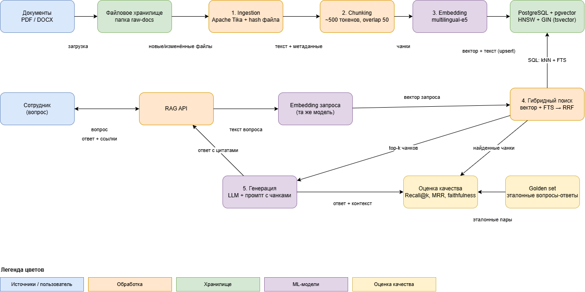
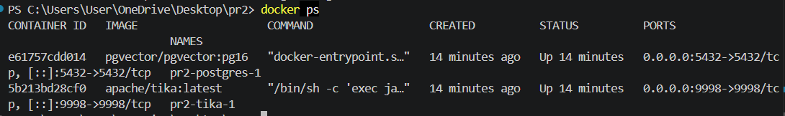
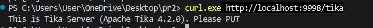
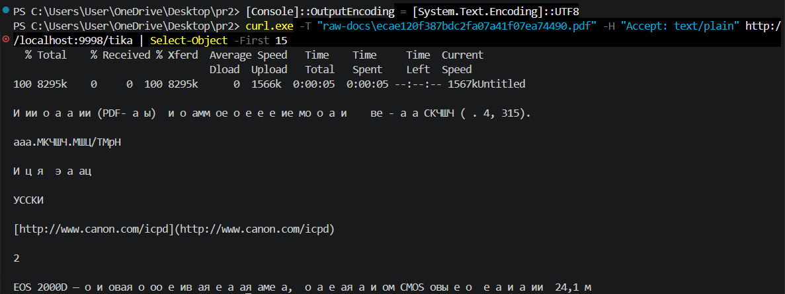
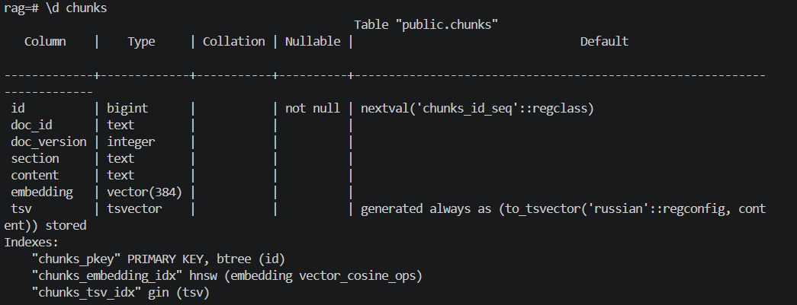
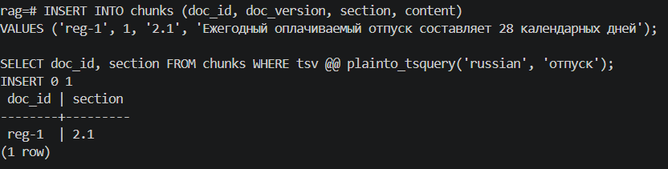
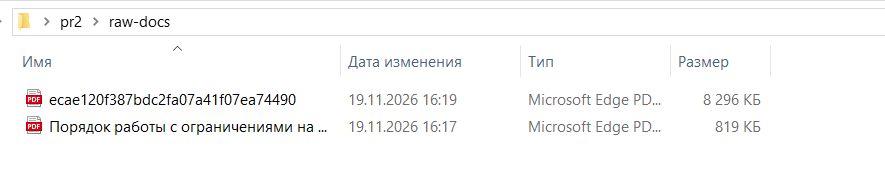

# Отчёт по практической №2

## 1. Вариант и задача

| Поле | Значение |
|---|---|
| ФИО | Тушинов Галсан Чингисович |
| Тема | 3 — RAG + векторная БД |
| Состав решения | папка `raw-docs` (сырые документы) → Apache Tika (парсинг) → chunking → embedding (multilingual-e5) → PostgreSQL + pgvector (HNSW + полнотекстовый индекс GIN) → гибридный поиск (вектор + FTS, объединение RRF) → LLM → оценка качества (golden set) |
| Данные, объём | Задача: тысячи регламентов и инструкций (PDF, DOCX). В демо: 2 реальных PDF-файла в `raw-docs` (около 8 МБ и 0,8 МБ) и 1 тестовая строка в таблице `chunks` |

## 2. Источники и способы сбора

| Источник | Тип | Способ сбора |
|---|---|---|
| Регламенты и инструкции компании | документы (PDF, DOCX) | Кладутся в локальную папку `raw-docs`. Парсер забирает только новые и изменённые файлы (сравнивает hash), чтобы не обрабатывать тысячи файлов заново при каждом запуске. |
| Вопросы сотрудников | API | Запрос в RAG API. Вопрос превращается в вектор той же моделью, что и документы. |
| Эталонные вопросы-ответы (golden set) | batch | Вручную собранный список из 30–50 вопросов с указанием правильного документа. Нужен для оценки качества поиска. |

## 3. Архитектура



Исходник: `architecture.drawio`.

Цвета: синий — источники и пользователь, оранжевый — обработка, зелёный — хранилище, фиолетовый — ML-модели, жёлтый — оценка качества (легенда есть на схеме).

В схеме вместо MinIO указано файловое хранилище (папка), потому что образ MinIO больше не скачивается.

Блоки из пройденного: 5 стадий RAG (ingestion, chunking, embedding, векторный поиск, генерация), векторная БД с индексом HNSW, гибридный поиск (вектор + полнотекст), оценка качества поиска.

## 4. Docker — что поднялось

| Блок схемы | Статус | Комментарий |
|---|---|---|
| Документы PDF | реализовано | 2 PDF лежат в `raw-docs` |
| Файловое хранилище `raw-docs` (вместо MinIO) | реализовано | Обычная папка. MinIO поднять не удалось: образ `minio/minio` больше не скачивается (`pull access denied`), разработчики убрали его из Docker Hub и Quay |
| Apache Tika | запущен | Контейнер в статусе Up, порт 9998, отвечает на запрос `curl` (скриншот ниже). Автоматическая загрузка файлов из папки в Tika не настроена |
| PostgreSQL + pgvector | реализовано | Создана таблица `chunks`, индексы HNSW и GIN |
| Полнотекстовый поиск | реализовано | Проверен на тестовой строке |
| Векторный поиск, RRF | только на схеме | Нет модели эмбеддингов, таблица с векторами пустая |
| Chunking, embedding | только на схеме | Слишком тяжело для ноутбука |
| RAG API, LLM | только на схеме | Не реализовано, в задании сказано, что модель поднимать не нужно |
| Оценка качества (golden set) | только на схеме | Описана методика, сами метрики не считал |

### Как запускалось

```powershell
docker compose up -d
```

Первый запуск закончился ошибкой при скачивании образа: `short read: expected 118047771 bytes but got 26824052: unexpected EOF`. Это сетевой сбой. Повторный запуск той же команды отработал успешно.

До этого первый вариант `docker-compose.yml` содержал MinIO. Он не запустился с ошибкой `pull access denied for minio/minio`, поэтому я убрал MinIO из compose-файла и заменил его папкой.

```powershell
docker ps
```

```
CONTAINER ID   IMAGE                    COMMAND                  CREATED          STATUS          PORTS                                         NAMES
e61757cdd014   pgvector/pgvector:pg16   "docker-entrypoint.s…"   13 seconds ago   Up 11 seconds   0.0.0.0:5432->5432/tcp, [::]:5432->5432/tcp   pr2-postgres-1
5b213bd28cf0   apache/tika:latest       "/bin/sh -c 'exec ja…"   13 seconds ago   Up 12 seconds   0.0.0.0:9998->9998/tcp, [::]:9998->9998/tcp   pr2-tika-1
```



Проверка Tika:

```powershell
curl.exe http://localhost:9998/tika
```



Проверка парсинга: отправил в Tika PDF из `raw-docs` (инструкция к фотокамере Canon EOS 2000D, использована как тестовый документ).

```powershell
curl.exe -T "raw-docs\ecae120f387bdc2fa07a41f07ea74490.pdf" -H "Accept: text/plain" http://localhost:9998/tika
```



Tika вернула текст, то есть этап ingestion работает. Но качество плохое: в русских словах пропало много букв (например, вместо «Перемотка» получилось «Пе мо е а»). Скорее всего, в этом PDF шрифты закодированы без корректной таблицы символов, и Tika не может восстановить часть русских букв. Для реальной системы это важная проблема: такой текст нельзя отдавать в chunking и embedding, иначе поиск будет работать плохо. Решение: проверять качество извлечённого текста (доля нечитаемых слов) и для таких файлов запускать OCR (например, Tika вместе с Tesseract) или другой парсер.

### Создание таблицы и индексов

```powershell
docker exec -it pr2-postgres-1 psql -U rag -d rag
```

```sql
CREATE EXTENSION IF NOT EXISTS vector;

CREATE TABLE chunks (
  id BIGSERIAL PRIMARY KEY,
  doc_id TEXT,
  doc_version INT,
  section TEXT,
  content TEXT,
  embedding VECTOR(384),
  tsv TSVECTOR GENERATED ALWAYS AS (to_tsvector('russian', content)) STORED
);

CREATE INDEX ON chunks USING hnsw (embedding vector_cosine_ops);
CREATE INDEX ON chunks USING gin (tsv);
```

Структура таблицы и индексы (`\d chunks`):



Столбец `embedding` имеет размер 384, это размерность выбранной модели `multilingual-e5-small`. Столбец `tsv` генерируется автоматически из текста чанка.

### Проверка полнотекстового поиска

```sql
INSERT INTO chunks (doc_id, doc_version, section, content)
VALUES ('reg-1', 1, '2.1', 'Ежегодный оплачиваемый отпуск составляет 28 календарных дней');

SELECT doc_id, section FROM chunks WHERE tsv @@ plainto_tsquery('russian', 'отпуск');
```

```
 doc_id | section
--------+---------
 reg-1  | 2.1
(1 row)
```

Запрос по слову «отпуск» нашёл тестовую строку, значит индекс GIN и русская морфология работают.



### Папка с документами



## 5. Описание пути данных

| Шаг | Для чего | Результат |
|---|---|---|
| Загрузка в папку `raw-docs` | Хранить оригиналы отдельно от индекса, чтобы можно было пересобрать всё заново | Файлы PDF/DOCX |
| Ingestion (Tika) | Достать текст из PDF/DOCX, убрать колонтитулы, сохранить метаданные (документ, версия, раздел) | Чистый текст + метаданные |
| Chunking | Модель не может прочитать весь регламент целиком. Режу по заголовкам на куски около 500 токенов с перекрытием 50, чтобы не рвать мысль на границе | Чанки |
| Embedding | Превратить смысл куска текста в вектор | Вектор из 384 чисел на чанк |
| Запись в pgvector | Хранить вектор, текст и метаданные в одном месте | Таблица `chunks` с индексами HNSW и GIN |
| Векторный поиск | Находить по смыслу («отпуск» ≈ «ежегодный оплачиваемый отдых») | Топ-N кандидатов |
| Полнотекстовый поиск | Находить точные слова: номера приказов, аббревиатуры, коды | Топ-N кандидатов |
| Объединение (RRF) | Совместить два списка в один | Итоговые top-k чанков |
| Генерация | LLM отвечает только по найденным чанкам и даёт ссылки на документ | Ответ с источниками |
| Оценка | Проверить, что система находит нужное и не выдумывает | Recall@k, MRR, faithfulness |

### Ответы на вопросы варианта

**5 стадий.**
- Ingestion: достаём текст и метаданные, обрабатываем только изменённые файлы.
- Chunking: делим по структуре документа, а не по фиксированному числу символов, чтобы кусок не обрывался посреди пункта.
- Embedding: одна и та же модель для документов и запросов, иначе векторы нельзя сравнивать.
- Векторный поиск: ищем ближайшие по смыслу чанки.
- Генерация: LLM собирает ответ из найденных чанков и указывает источник.

**Векторная БД и индексы.** Выбрал PostgreSQL с расширением pgvector. Метаданные документов (версия, раздел, права доступа) хранятся в той же БД, и не нужен отдельный сервис. Индекс HNSW даёт быстрый приближённый поиск и хорошую точность, но занимает больше памяти и дольше строится. IVFFlat проще, но качество ниже и ему нужны данные для построения. Для нескольких тысяч документов HNSW подходит.

**Зачем гибридный поиск.** Векторный поиск хорошо понимает смысл, но плохо находит точные значения (номер приказа, код формы). Полнотекстовый поиск наоборот. Объединение двух списков через RRF даёт результат лучше, чем каждый способ по отдельности.

**Как оцениваю качество поиска.** Собираю golden set из 30–50 вопросов, для каждого указан правильный документ. Считаю Recall@k (попал ли нужный чанк в top-k) и MRR (на каком месте он оказался). Для ответов смотрю faithfulness: опирается ли ответ на найденные чанки. По этим метрикам подбираю размер чанка и значение k.

**Роль data engineer.**
- На мне: приём документов, парсинг, чанкинг, метаданные и права доступа, обновление по версиям, удаление устаревших регламентов, качество данных, мониторинг пайплайна, индексы.
- Не на мне: обучение и дообучение LLM, написание промптов, выбор архитектуры модели (это работа ML-инженера).

## 6. Выводы

В этой работе я спроектировал архитектуру RAG для поиска по регламентам и поднял её часть, связанную с хранением: PostgreSQL с pgvector, индексы HNSW и GIN, парсер Tika и папку с документами. Полнотекстовый поиск проверил на тестовой строке. Векторный поиск, chunking, модель эмбеддингов и LLM остались только на схеме.

Больше всего пришлось повозиться с запуском. Сначала образ MinIO перестал скачиваться, и я заменил его папкой. Потом при загрузке образа произошёл сетевой сбой, который решился повторным запуском.

Главное, что я понял: качество ответа в RAG зависит от подготовки данных не меньше, чем от самой модели. Размер чанков, метаданные и версии документов влияют на результат сильнее, чем кажется. Гибридный поиск нужен из-за точных терминов и номеров в регламентах, где чисто векторный поиск ошибается.

## Мой любимый десерт

Сейчас мой любимый десерт является булочка с корицей со сливочным кремом(Синобон)(っˆڡˆς)